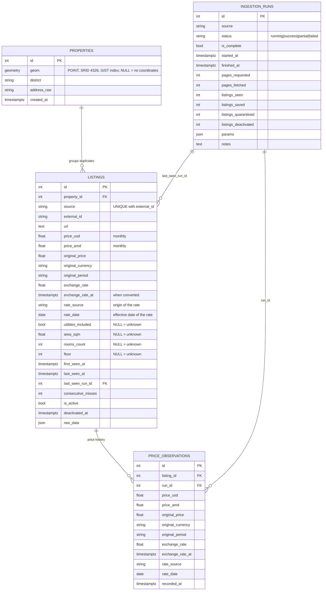

# Storage, ingestion policy and ER diagram [A02][A03][A04]

## ER diagram (implemented tables)



**Not implemented yet:** `infrastructure`, `estimates`, `signals`, `reviews`. They are part of the A02 goal but
their columns depend on the backend/analytics contract and were not specified, so they are deliberately not
invented here. Add them as further Alembic revisions once the contract is agreed.

Constraints and indexes that protect the data: `UNIQUE (source, external_id)` (source identity),
`CHECK` on positive original price / exchange rate, non-negative miss counter and run status values,
GiST index on `properties.geom`, indexes on `listings(source, is_active)`, `listings(property_id)`,
`price_observations(listing_id, recorded_at)`, `ingestion_runs(source, started_at)`.

## Migrations

```
89c3800d8fdf  init schema with postgis and price history   (A02)
3f9a6c2e1b84  ingestion runs, provenance, lifecycle
5b7d2e91c4a6  exchange-rate provenance: rate_source, rate_date
```

Verified on an empty PostgreSQL 16 + PostGIS 3.4 database (also with `postgis_topology`, `postgis_tiger_geocoder`
and `fuzzystrmatch` installed, as in the standard postgis image): `alembic upgrade head`, `alembic check`
(models == migrated schema), `alembic downgrade base`, `alembic upgrade head`; and on a database that already
contained rows (backfill: `source='list.am'`, `url` from `raw_data`, first/last seen from `created_at`).
Requires the `postgis` extension to exist (`CREATE EXTENSION postgis`) before the first revision.

Two fixes were needed in the first revision (`89c3800d8fdf`): it created `idx_properties_geom` twice (GeoAlchemy2
already creates it with the table) and it dropped PostGIS's own `spatial_ref_sys` table. Keep
`include_object` in `env.py` so autogenerate ignores `spatial_ref_sys`.

## Ingestion policy (A03/A04)

**Normalization.** Period is converted first, then currency: `monthly_usd` and `monthly_amd` always describe
the same month (daily x30, weekly x4.33, yearly /12). Original price, currency, period, the exchange rate and
its timestamp are stored on the listing and on every price observation. Rates are static configuration
(`normalizer.EXCHANGE_RATES`), not live rates, which is why the rate used is stored. Utilities: `NULL`
(= unknown, `utility_cost_uncertainty = true`) unless the source says otherwise.

**Idempotency.** A listing is identified by `(source, external_id)`. Re-running never duplicates listings; a
`price_observations` row is added only when the original price, currency, period or normalized amounts change.

**Run completeness.** A run is *complete* only if pagination reached its end, no index page failed, and neither
`--pages` nor `--max-listings` stopped it early. "Reached its end" means an empty page after page 1 **that is
recognised as a genuine catalogue page** (same wrapper as page 1, no CAPTCHA/"Access denied" wording). A blocked,
unrecognised or markup-changed page is an index failure, so the run is partial and deactivates nothing.
Everything else (including a crash or a file import) is not complete.

**Staleness policy.** Only a complete run evaluates inactivity:

1. every listing seen on an index page is marked seen: `last_seen_at`/`last_seen_run_id` updated,
   `consecutive_misses = 0`, reactivated if it was inactive (a failed or invalid detail page still counts as seen);
2. every other active listing **of the same source** gets `consecutive_misses + 1`;
3. at `consecutive_misses >= STALENESS_RUNS` (default **2**, weekly runs -> about two weeks) the listing becomes
   `is_active = false` with `deactivated_at`; rows are never deleted.

Safeguards: a complete run that saw fewer than `MIN_SEEN_RATIO` (default 50%) of the currently active listings is
recorded as `partial` with a note and deactivates nothing (blocked/empty pages); a failed run deactivates
nothing; staleness is scoped per `--source-name`, so use one name per collected segment.

**Coordinates.** Both missing is valid: the listing is stored with a `Property` whose `geom` is NULL, stays available
for search and detail views, and is excluded from map results (`queries.map_listings`). Exactly one coordinate, or a
non-numeric/out-of-range value, is rejected. Listings without coordinates are never grouped. If coordinates later
arrive or are corrected for an existing listing:

* property used only by this listing: its `geom` is updated in place (or the listing joins the matching property
  if the corrected position matches a known flat; the emptied property is left in place, never deleted);
* property shared with other listings: it is **never moved**. If the corrected position is within 15 m the listing
  stays; otherwise it joins the matching property or gets its own new property at the corrected position;
* moves under 1 m are treated as rounding noise; missing coordinates never erase a known position.

**Integer fields.** `rooms_count`, `floor`, `total_floors` accept only integral values (`2`, `2.0`, `"2"`). A
non-integral value such as `2.9` is stored as unknown (NULL), not truncated, and the original value is kept in
`raw_data.rejected_fields` (also used for values refused as contradictory, e.g. floor above total floors).

**Exchange-rate provenance.** `rate_source` (where the rate comes from) and `rate_date` (its effective date) are
stored separately from `exchange_rate_at`, which is only when the conversion ran. The rates are static approximate
constants (`rate_source = "static-config"`, `rate_date` = the date they were set; both overridable with the
`EXCHANGE_RATE_SOURCE` / `EXCHANGE_RATE_DATE` environment variables). Rows stored before this revision have
`rate_source = 'static-config'` and `rate_date = NULL` (unknown). Replace the static table with a real feed when
one is chosen.

**Alembic scope.** `database/alembic_filters.py` restricts autogenerate to the tables declared in the models and to
the default schema, so extension-owned tables (`spatial_ref_sys`, `tiger.*`, `topology.*`, ...) are never reported by
`alembic check`.

**Duplicate grouping** (`grouping.py`). A new listing joins an existing `Property` only if, within the same
source, area, rooms and floor are all known; rooms and floor are equal; total floors are equal when both are
known; area differs by <= 0.5 m2; and coordinates are within 15 m. Unknown values never match. Listings are never
merged or deleted: grouping only shares `property_id`, so it is reversible. Verified with synthetic data: the
same flat advertised twice is grouped, while the same building with a different floor, a bigger flat, or unknown
attributes stays separate. Known limit: two genuinely different flats with identical floor, area and rooms at the
same coordinates would be grouped; tighten the rule (e.g. address text) if that appears in real data.

## Seed data

`data_pipeline/seed_data.json` (6 synthetic listings, source `synthetic`) demonstrates grouping, AMD daily
prices and unknown attributes: `python -m data_pipeline.cli import-file data_pipeline/seed_data.json --source-name synthetic`.

## Coordination with backend

* Schema owner: the data pipeline (changes only through Alembic revisions).
* `price_usd` / `price_amd` are **monthly** amounts; use `original_*` for what the ad actually said.
* Unknown values are `NULL`, never `0`; use `is_active` and `last_seen_at` to filter stale inventory.
* All new timestamps are `timestamptz` (existing ones converted, assuming UTC).
* `Property.geom` can be NULL (listing without coordinates): use `queries.map_listings` or `geom IS NOT NULL` for maps.
* Rate provenance: `rate_source`, `rate_date`; `exchange_rate_at` is the conversion time only.
* `(source, external_id)` replaced the old unique index on `external_id` alone.
* Breaking changes should be announced to backend before merge. This still needs to be agreed with them.
