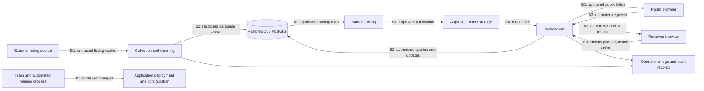

# E01: FairRent assets and security risk assessment

Status: draft for component-owner review. Coordinator: Mane (@manemazmand).
This assessment does not certify FairRent or prove that proposed protections work.
Task: [E01 acceptance criteria](implementation-plan.md#e01).
Evidence baseline: repository commit `23f4244`; later changes require reassessment.

## Purpose and evidence

An asset is something valuable that needs protection. This assessment identifies
assets, follows their movement through FairRent, and proposes protections against
plausible harm. A proposed risk is not a confirmed vulnerability (a demonstrated
weakness). Component owners must review their assignments and assumptions.

Evidence inspected:

- [`database/models.py`](../database/models.py): listing prices and history, addresses, coordinates,
  descriptions, raw source data, and collection-run records are defined.
- [`data_pipeline/scraper.py`](../data_pipeline/scraper.py): collection logging and quarantined records exist.
  Quarantine means holding a rejected record separately for investigation.
- [`backend/main.py`](../backend/main.py): only `/health` and `/ready` are implemented here.
- [`contracts/openapi.json`](../contracts/openapi.json): reviewer access is specified, but a specification
  describes intended behavior; it does not implement or verify authorization.
- `compose.yml`, `.env.example`, `.gitignore`: local database configuration,
  example development credentials, and exclusions from version control exist.
  Ignoring a file does not protect it from other users or erase past commits.
- `docs/technology-stack.md`, `ml/CONTRACT.md`: intended AWS architecture and
  model handling. Deployment, real reviewer accounts, and stored production
  models have not been verified by this assessment.

## Terms used in this assessment

| Term | Plain meaning |
| --- | --- |
| Confidentiality (C) | Information is visible only to permitted people or systems. |
| Integrity (I) | Information and software remain accurate and change only in authorized ways. |
| Availability (A) | Information and services are usable when needed. |
| Classification | A handling label: Public, Internal (team only), or Restricted (explicitly approved access). These are proposed project labels. |
| Owner | The person responsible for deciding how an asset is handled, not necessarily its only user. |
| API / endpoint | An interface programs call; an endpoint is a particular operation/address on it. |
| Database | Organized persistent storage; PostgreSQL is FairRent's database software. PostGIS adds geographic operations. |
| Pipeline / ingestion | A sequence of processing steps / bringing source data into the system. |
| Credential / secret | A password, key, or other sensitive value granting access. |
| Token / session | A value presented as evidence of access / a user's continuing signed-in interaction. |
| Authentication / authorization | Checking who someone is / deciding what that identity may do. |
| Role / least privilege | A named permission group / granting only the permissions a task needs. |
| Model artifact | A saved trained model and related files needed to produce predictions. |
| Logs / audit trail | Event records such as job failures / records linking important actions to actors, times, and outcomes. |
| Trust boundary | A crossing where the recipient must reassess the sender's identity, permissions, or data. |
| Threat / vulnerability / risk | Possible harm / a weakness enabling harm / an assessment of the harm's likelihood and impact. |
| Control / residual risk | A measure reducing risk / risk remaining after that measure is implemented and verified. |
| Validation / sanitization | Checking data against rules / transforming it to remove unsafe content. Neither replaces authorization. |
| Parameterized query | A database request that keeps supplied values separate from executable query instructions. |
| Redaction / retention | Removing sensitive details / how long records are kept before deletion. |
| Rate limit / timeout | A cap on request frequency / a limit on how long work may run. |
| Dependency / CI | External software a project uses / automated checks run when code changes (continuous integration). |
| Deployment / IAM | Making an application run in its hosting environment / AWS identity and access management, separate from application reviewer roles. |
| TLS / checksum | Encrypted, authenticated transport / a file fingerprint detecting changes when compared with a trusted expected value. |
| Incident | An actual or suspected event that compromises security. |

AWS is Amazon's hosting platform. S3 stores files; RDS hosts databases; ECS runs
application containers (packaged application processes); CloudWatch collects
operational records. Their use below describes planned architecture.

## Asset inventory

Ratings describe the consequence of losing C, I, or A: High means serious harm
to permissions, privacy, or trustworthy results; Medium means meaningful but
bounded disruption; Low means limited harm. They are reasoned proposals, not
measurements. A public subset can have a different classification from its source.

| Asset and evidence | Proposed accountable owner | Location / status | Classification and permitted access | C / I / A and reason |
| --- | --- | --- | --- | --- |
| Published listing fields: approved prices, areas, districts, descriptions | Alisa (@alisamanukyann); Artyom serves the API | Database definitions exist; public business API planned | Public only after field review; pipeline writes, public reads approved fields through API | Low / High / Medium: altered data damages valuations; outages stop browsing |
| Raw listings, precise coordinates/addresses, rejected records | Alisa | `raw_data`, property fields, scraper quarantine; actual stored contents uninspected | Restricted until reviewed; data owner and explicitly authorized processors | High / High / Medium: free text may contain personal details; bad inputs contaminate results |
| Price history, exchange-rate origin/date, collection-run records | Alisa | Database definitions exist | Internal by default; publish only approved aggregates or fields | Medium / High / Medium: historical and source records support correct calculations and investigation |
| Reviewer identities, roles, session credentials, review decisions | Artyom (@Artyomkrtchyan); Mane owns frontend handling | Reviewer contract exists; identity storage and authentication design unverified | Restricted; reviewers access assigned permissions; administration separately authorized | High / High / Medium: impersonation or altered decisions undermines review |
| Database, deployment and service credentials | Artyom; each member protects their own account | Local environment configuration exists; production bindings unverified | Restricted; authorized operators and relevant service only; never browser code | High / High / High: disclosure may permit data theft, changes, or service shutdown |
| Training data, trained model, preprocessing files and evaluation outputs | @Lazr22 | ML contract; S3 storage planned; production artifacts unverified | Internal by default; training source data inherits its own restrictions; only model owner/release process writes approved models | Medium / High / Medium: changed models or preprocessing corrupt predictions; data may be sensitive |
| Application/collection logs and security audit records | Artyom (application); Alisa (collection); Mane coordinates review | Scraper logs and run records exist; centralized audit coverage unverified | Internal; Restricted when containing identities or sensitive diagnostic details | Medium / High / Medium: records support investigations; secret/personal-data logging increases confidentiality impact |
| Repository, automated workflows and release files | Artyom coordinates; each component owner reviews its changes | Git repository and backend CI exist | Source visibility follows repository settings (unverified); trusted team/release process writes | Depends on contents / High / Medium: unauthorized changes can affect all deployed components |

No real personal data, credentials, or raw exports should be copied into this
document. No specific legal retention period is asserted; owners must agree one
before collecting sensitive production data.

## Data flow and trust boundaries

The diagram shows the intended business flow. It does not claim those connections
are deployed. The current backend health checks do not implement this full flow.

- **B1 — source to collection:** external text and links are untrusted even if
  the source website is familiar. Check format, size, accepted URLs, and errors.
- **B2 — processes to database:** give each process only needed permissions;
  keep public users from connecting directly; use parameterized queries.
- **B3 — browser to API:** users can alter requests outside the interface.
  Validate inputs and enforce authorization on the server for every protected action.
- **B4 — model publication/loading:** allow only approved writers and trusted
  artifacts. Some model formats can execute code when loaded; determine actual
  formats before selecting controls. A checksum from the same untrusted sender
  is not proof of authenticity.
- **B5 — changes to running software:** restrict release permissions, review
  changes, and prevent secrets from entering source, build output, or logs.
- **Logs:** accepting event data is another trust crossing. Do not interpret
  untrusted text as commands; restrict reading, writing, and deletion of records.

## STRIDE threat model and prioritized risk register

STRIDE groups threats: **Spoofing** (pretending to be another identity),
**Tampering** (unauthorized changes), **Repudiation** (denying actions without
adequate evidence), **Information disclosure** (revealing restricted information),
**Denial of service** (preventing legitimate use), and **Elevation of privilege**
(gaining permissions beyond those granted).

Likelihood: High = readily reachable with few obstacles; Medium = plausible but
requires conditions; Low = difficult or narrowly exposed. Impact uses the asset
consequences above. Priority P1 means resolve or explicitly accept before exposing
the affected feature; P2 means resolve before release. These are risk-register
priorities, separate from the board's task priorities.

All entries below are assessment scenarios, not confirmed exploitable findings.
Likelihood is provisional because deployment and access controls are unverified.
Residual risk is **unassessed** until controls are verified; target ratings are goals.

| ID / priority | STRIDE / boundary and scenario | Likelihood and impact, with basis | Existing evidence / proposed control | Proposed remediation owner and verification | Residual risk |
| --- | --- | --- | --- | --- | --- |
| R01 / P1 | Spoofing, elevation / B3: someone impersonates a reviewer or performs forbidden updates | Medium: protected operations are specified but implementation unverified. High: review integrity and identities affected | Contract requires reviewer role; implement server-side identity, role and per-object permissions, credential expiry and revocation | Artyom with Mane; E03 tests missing/expired/invalid credentials, wrong role and forbidden object changes | Unassessed; target Low |
| R02 / P1 | Information disclosure / B5, browser, logs: credentials leak | Medium: several configuration/build paths handle secrets. High: credentials can grant broad access | `.env` ignored; sample local credentials are not production protection. Keep secrets out of frontend and Git, restrict service access, rotate exposed values, add E02 checks | Artyom with Mane; inspect build/log handling and verify harmless synthetic secret detection | Unassessed; target Low |
| R03 / P1 | Tampering / B1–B3: crafted text or requests alter queries or execute browser content | Medium: descriptions and raw fields accept external content. High: unauthorized data changes or session compromise possible | Implement bounded input validation, parameterized queries, safe text rendering and external-link handling; inspect existing paths before alleging a flaw | Alisa (storage), Artyom (API), Mane (UI); E03 tests representative malicious inputs in owned test systems | Unassessed; target Low |
| R04 / P1 | Information disclosure / B1–B3: raw records or precise location details are published unintentionally | Medium: raw text/address fields exist; actual contents unknown. High if identifying details escape | Explicit public-field list; restrict raw exports, review source fields, redact logs, agree retention/deletion rules | Alisa with Artyom; compare public responses and logs with approved fields using synthetic sensitive markers | Unassessed; target Low |
| R05 / P1 | Tampering, elevation / B4: untrusted model file is loaded | Medium: artifact flow planned, protections unverified. High: wrong valuations or possible code execution depending on format | Restrict writers/readers, record approved version and trusted checksum, select safe loading/format, reject unapproved artifacts | @Lazr22 with Artyom; E04 verifies changed/unapproved artifact rejection | Unassessed; target Low |
| R06 / P2 | Denial of service / B3: repeated expensive requests exhaust resources | Medium: geographic/valuation operations planned. Medium: browsing or valuation becomes unavailable | Bound page sizes, geographic ranges and request sizes; use timeouts and rate limits appropriate to expected traffic | Artyom; E03 bounded tests verify limits without load-testing shared services | Unassessed; target Medium |
| R07 / P2 | Repudiation, tampering / logs: review changes cannot be attributed or records are altered | Medium: operational records exist, reviewer audit design unverified. High: disputed decisions cannot be reliably investigated | Record actor, action, object, time and outcome for security-relevant actions; restrict modification/deletion; exclude secrets | Artyom with Mane; verify allowed and rejected updates leave suitable records and ordinary reviewers cannot alter them | Unassessed; target Low |
| R08 / P1 | Tampering, information disclosure / B5: compromised dependency or release workflow changes deployed software | Medium: external packages and CI are used. High: runtime and data can be affected | Review workflow permissions, dependencies and container findings; restrict release access and review updates | Artyom with Mane; E02 scanner fixtures and configuration review; E05 retest | Unassessed; target Medium |
| R09 / P2 | Tampering, denial / B1–B2: incomplete collection incorrectly removes active listings | Medium: source failures are foreseeable. Medium: inventory and market results become misleading | Code defines run completeness and lifecycle tracking; preserve these controls and verify incomplete-run behavior rather than assuming it works | Alisa; run relevant existing lifecycle tests, review failure handling | Unassessed; target Low |
| R10 / P1 | Information disclosure, tampering / B3–B4: network traffic is intercepted or redirected | Medium: hosting and transport configuration are unverified. High: identities, restricted data or model files could be exposed or changed | Require HTTPS for public traffic and authenticated TLS for sensitive service connections; preserve certificate verification; local loopback development does not demonstrate production transport security | Artyom with Mane; E04 verifies deployed certificate validity, HTTPS behavior and sensitive service connection settings | Unassessed; target Low |
| R11 / P1 | Information disclosure, elevation / B1: a manipulated source link makes the collector contact an internal service | Medium: collector follows links and redirects; destination restrictions need review. High if internal services or credentials become reachable | Restrict allowed source hosts and schemes, check redirect destinations, and block internal/private destinations where applicable; do not assume this is exploitable without testing | Alisa with Artyom; E03 uses controlled synthetic destinations to verify rejected URLs and redirects without probing real internal services | Unassessed; target Low |

## Proposed procedures and framework mapping

NIST CSF 2.0 (National Institute of Standards and Technology Cybersecurity
Framework) organizes security outcomes. The function names below are mappings
for planning, not evidence of certification or complete framework compliance.
Reference: [NIST CSF 2.0](https://doi.org/10.6028/NIST.CSWP.29).

| Procedure / selected control | NIST CSF function | Accountable coordinator |
| --- | --- | --- |
| Review asset owners, data handling and risk decisions when architecture changes | Govern; Identify | Mane with all component owners |
| Restrict accounts and service permissions; remove access when roles end | Protect | Artyom; asset owners approve scope |
| Keep credentials out of Git/browser/logs; rotate after suspected exposure | Protect | Artyom with each credential owner |
| Record important actions and investigate security alerts | Detect | Artyom with Mane |
| Privately report, assess and contain suspected compromise | Respond | Mane coordinates; component owner contains |
| Restore trusted service/data and verify fixes before returning to normal | Recover | Artyom with affected owners |

### Access procedure

1. Request access for a specific task, asset and duration from its owner.
2. Owner approves the smallest needed role; Artyom applies infrastructure access,
   and the backend owner applies application access. These are separate systems.
3. Use individual accounts and multifactor authentication where supported
   (a second proof of identity, such as an authenticator app). Avoid shared accounts.
4. Remove unneeded access when work or membership ends. Before release and after
   role changes, owners review who can read, write, publish, and administer assets.

### Secret-handling procedure

1. Use development-only configuration locally; never reuse sample credentials in
   a publicly exposed environment. Store production values in the approved secret
   facility selected by the deployment owner; that facility is not verified here.
2. Grant each service only its required secrets. Never put secrets in `VITE_*`
   settings: those values become readable by browser users.
3. Do not paste values into chat, issues, screenshots or logs. Report the secret's
   name and affected service, not its value.
4. If exposure is suspected, notify the owner privately, revoke/rotate the value
   (invalidate/replace it), assess use, and retest affected services. Deleting a
   file or commit alone does not invalidate an exposed credential.

### Incident-reporting procedure

1. Privately notify Mane and the affected component owner through a team-agreed
   private channel. The exact channel and backup contact still need agreement;
   do not post sensitive evidence in a public issue.
2. Record time with timezone, affected component, observed behavior, likely impact,
   and minimal redacted evidence. Separate observations from assumptions.
3. Owner assesses urgency; active credential misuse or unauthorized access receives
   immediate containment, such as revoking access or disabling the affected action.
4. Preserve relevant restricted logs and avoid unnecessary data deletion. Agree
   containment/recovery actions with the responsible owner.
5. Repair and retest; document cause, impact, remaining risk and follow-up work.
   E05 will expand this into the operational incident runbook (step-by-step guide).

## Review and completion gates

The document covers all three E01 acceptance criteria: the asset inventory covers
ownership, classification and C/I/A; the flow and risk register cover boundaries,
STRIDE, likelihood, impact, controls and remaining risk; the procedures and mapping
cover access, secrets, incident reporting and NIST CSF. Agreement is a separate
completion condition and must not be inferred from the document being pushed.

- [ ] Alisa confirms source-field handling, data access, retention, and R03/R04/R09.
- [ ] Artyom confirms identity design, secret storage, release permissions, log
  handling and proposed backend/infrastructure risk ownership.
- [ ] @Lazr22 confirms model format, publication/loading permissions and R05.
- [ ] Mane confirms frontend responsibilities and coordinates priority decisions.
- [ ] Team agrees a private incident-reporting channel and backup contact.
- [ ] Owners record accepted controls, target work, and any accepted remaining risk.
  Acceptance must name the decision-maker, reason, date and review deadline.

Use the following decision log during pull-request review. A pull request is a
proposal to merge branch changes; comments can provide links to review evidence.
Do not fill in approvals on behalf of other owners.

| Scope | Decision-maker | Decision / reason | Evidence link | Decision date / next review |
| --- | --- | --- | --- | --- |
| Data assets, retention, R03/R04/R09/R11 | Alisa | Pending | Pending | Pending |
| Backend, credentials, deployment, R01–R08/R10/R11 as applicable | Artyom | Pending | Pending | Pending |
| Model assets and R05 | @Lazr22 | Pending | Pending | Pending |
| Frontend handling and assessment coordination | Mane | Pending | Pending | Pending |
| Private reporting channel and backup contact | Team | Pending | Pending | Pending |

The asset inventory, flow diagram, STRIDE scenarios, risk register, proposed
procedures and framework mapping are drafted. Owner agreement remains pending;
E01 must not be reported as fully complete until that review is recorded.
