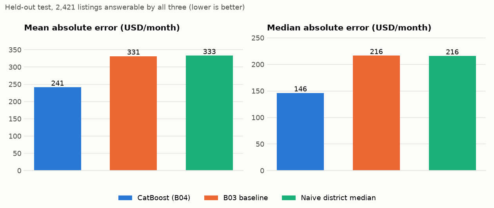
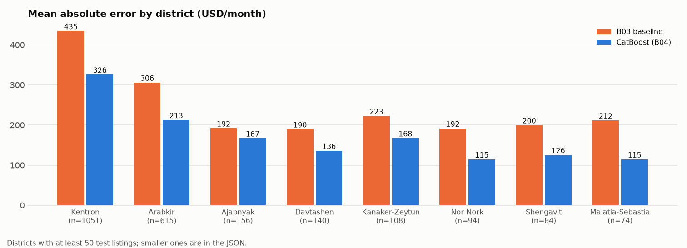
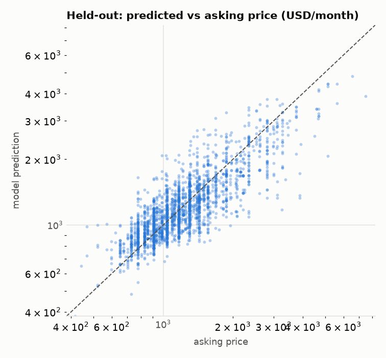
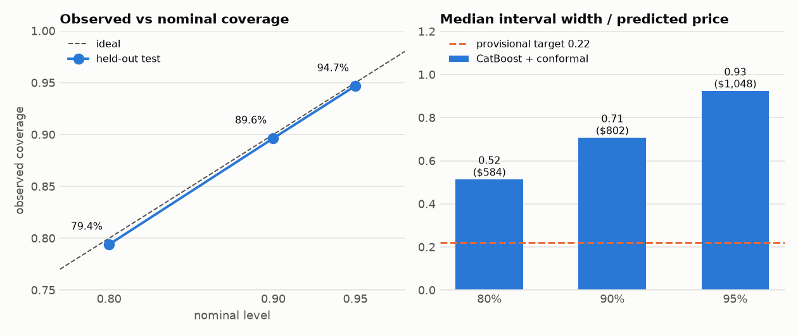
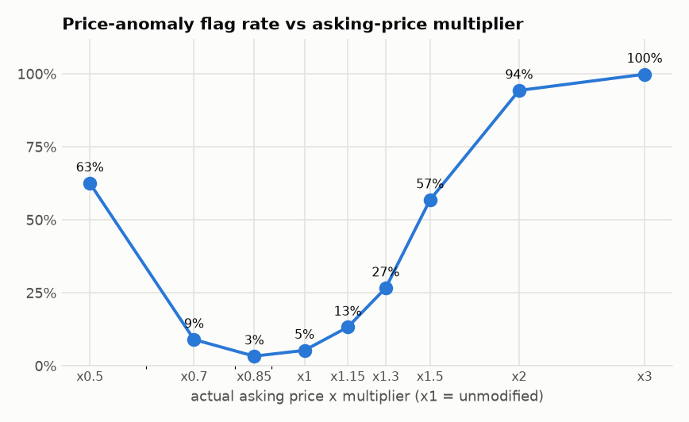
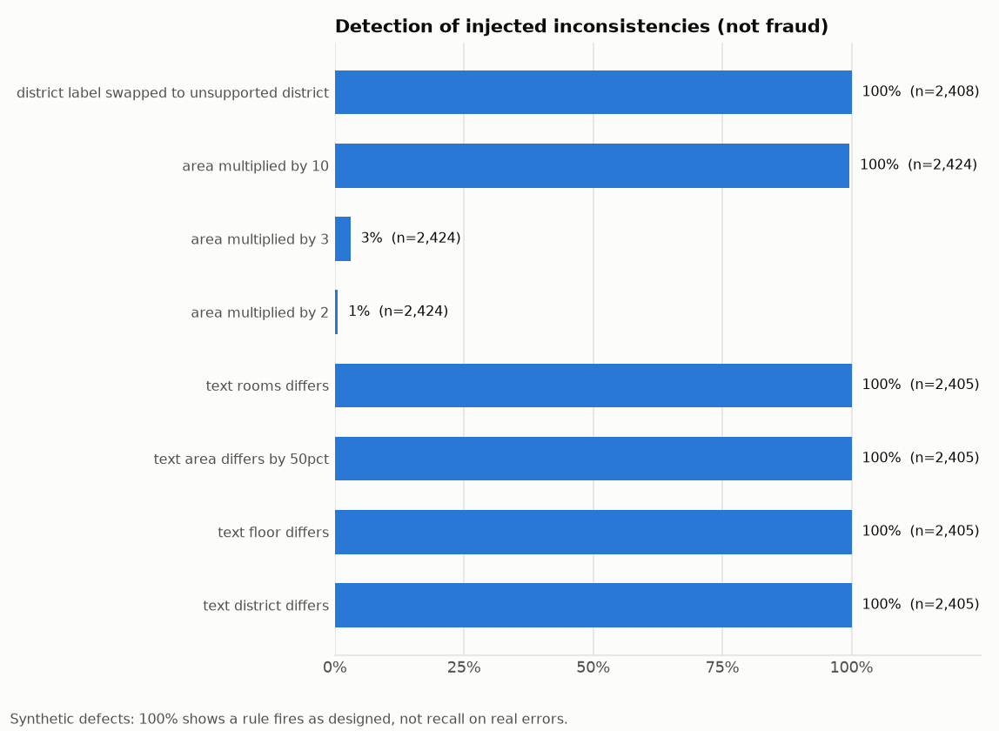

# Model card: Fairrent rental price estimate and rule engine

Generated by `ml.evaluation_evidence` (evidence version `b08-v1`). Every number below comes from the B04/B05 reports or from the commands in section 9; nothing is typed in by hand.

## 1. Summary

- Estimates the **monthly asking rent in USD** of a Yerevan apartment from its coordinates and, optionally, area, rooms, floors, district and building type. The estimate comes with a conformal prediction interval.
- On 2,421 held-out listings the CatBoost model has a mean absolute error of **$241.24** versus **$331.30** for the B03 comparable-median baseline (27% lower), and a median absolute error of $146.14 versus $216.45.
- The nominal 95% interval covered **94.7%** of held-out asking prices, but it is wide: median width $1,048 (**0.93** of the predicted price; provisional target 0.22 is NOT met).
- Risk rules (section 6) are evaluated separately. **Fraud accuracy was not measured**: no labelled fraud data exists.

## 2. Intended use and out of scope

**Intended:** decision support for a municipal reviewer or a renter comparing an asking price with a calibrated range for similar listings; surfacing listings whose data is inconsistent so a person can look at them.

**Not intended / not supported:**
- Deciding that a listing is fraudulent. A price outside the interval and a rule finding are *review evidence* only.
- Signed rents, sale prices, or any city other than Yerevan (coordinates outside the coverage box are rejected).
- Forecasting future prices. The evaluation is in-time (see limitations).
- Automated action against a landlord or advertiser.

## 3. Versions and data

| Item | Value |
|---|---|
| Package | `v1.0.0-b07` (interface `b07-v1`) |
| Model | `b04-v1.0.0-grouped-merged-catboost` (CatBoost, MAE loss) |
| Calibration | `b05-v1.0.0-relative`, method `relative`, primary level 0.95 |
| Rules | `b06-rules-v1.0.0`, geography `yerevan-geo-v1`, ontology v1.1 |
| Dataset | `v1.0.0-grouped-merged`, snapshot SHA-256 `5b09c0999cfebdbd...` |
| Rows (train / validation / test) | 11,186 / 2,427 / 2,424 |
| Data as of | 2026-10-31T10:10:10Z |
| Split | grouped-random (one-date scrape), duplicate groups isolated |
| Leakage checks | passed |

Source: asking-price listings scraped from list.am, converted to USD per month by the A06 pipeline. Targets are asking prices, not signed rents.

## 4. Price error (held-out test)

Same 2,421 rows for every model (rows the baseline can answer; baseline abstained on 3). Lower is better except R-squared.

| Model | MAE (USD) | Median AE (USD) | MAPE (%) | RMSE (USD) | R-squared |
|---|---|---|---|---|---|
| CatBoost (B04) | 241.24 | 146.14 | 16.92 | 393.29 | 0.694 |
| B03 baseline | 331.30 | 216.45 | 24.27 | 709.94 | 0.003 |
| Naive district median | 332.87 | 215.78 | 24.52 | 710.60 | 0.001 |

Serving decision rule: *ML only if MAE < baseline MAE and median AE <= baseline median AE on commonly answered test rows*. Decision: **ml**. Largest model inputs by importance: area_sqm (35.8), distance_center_m (13.9), total_floors (8.4), latitude (7.0), distance_university_m (6.8).







### Prediction intervals

| Nominal | Observed coverage | Median width (USD) | Median width / price |
|---|---|---|---|
| 80% | 79.4% | 584 | 0.52 |
| 90% | 89.6% | 802 | 0.71 |
| 95% | 94.7% | 1,048 | 0.93 |

Coverage target 92%: met. Width target 0.22: NOT met. Intervals are withheld for 1.3% of rows (area_outside_training_range: 23, sparse_local_training_data: 8).



## 5. Ontology and competency questions

Ontology v1.1: 144 schema/sample triples; the evaluation graph adds rule output for 300 held-out listings (11,992 triples in total). Inferred facts and learned price effects are disjoint: **True**.

| Competency question | Answers | Listings |
|---|---|---|
| CQ1: Which listings have an inferred metro-proximity fact? | 77 | 60 |
| CQ2: Which listings carry a price-anomaly finding? | 18 | 18 |
| CQ3: Which listings have a description/location/feature consistency finding? | 0 | 0 |
| CQ4: Which facts could not be determined because data is missing? | 0 | 0 |

CQ4 has no answers here because every sampled listing has coordinates; the missing-data case is demonstrated by the worked examples.

Three worked examples (typical, inconsistent, missing data) are in `ontology_evaluation.json` and `ontology/examples/b06_inference_examples.json`.

### Proximity: inferred fact versus price effect

Near-metro listings (within 500 m) have a median price per m2 1.25x that of far ones (beyond 1000 m; 95% bootstrap CI 1.19-1.30). Inside districts the ratio is Arabkir 1.08 (0.96-1.21); Kentron 1.20 (1.13-1.32). The gap shrinks inside districts, so much of it is location mix. Descriptive, not causal.

## 6. Risk rules (evaluated separately from price error)

No fraud labels exist. The numbers below therefore measure rule behaviour, not fraud detection.

**Price anomaly.** 5.3% of ordinary held-out listings have an asking price outside the calibrated interval, as expected from 95% intervals; it is not a fraud rate. Flagging needs a large deviation because the interval is wide:

| Asking price vs actual | x0.5 | x0.7 | x0.85 | x1 | x1.15 | x1.3 | x1.5 | x2 | x3 |
|---|---|---|---|---|---|---|---|---|---|
| Flagged | 63% | 9% | 3% | 5% | 13% | 27% | 57% | 94% | 100% |



**Consistency rules on unmodified held-out listings** (flagged / clear / unknown):

| Rule | Flagged | Clear | Unknown |
|---|---|---|---|
| DESC-AREA-MATCH | 0 | 0 | 2424 |
| DESC-DISTRICT-MATCH | 0 | 0 | 2424 |
| DESC-FLOOR-MATCH | 0 | 0 | 2424 |
| DESC-ROOMS-MATCH | 0 | 0 | 2424 |
| FEAT-AREA-PLAUSIBILITY | 1 | 2423 | 0 |
| GEO-DISTRICT-SUPPORT | 0 | 2408 | 16 |

Description rules are `unknown` on this data because the export carries no free text.

**Detection of injected inconsistencies** (synthetic defects; recall with 95% Wilson interval):

| Experiment | Rule | Detected / n | Rate | 95% CI |
|---|---|---|---|---|
| district label swapped to unsupported district | GEO-DISTRICT-SUPPORT | 2,408 / 2,408 | 100.0% | 99.8%-100.0% |
| area multiplied by 10 | FEAT-AREA-PLAUSIBILITY | 2,414 / 2,424 | 99.6% | 99.2%-99.8% |
| area multiplied by 3 | FEAT-AREA-PLAUSIBILITY | 73 / 2,424 | 3.0% | 2.4%-3.8% |
| area multiplied by 2 | FEAT-AREA-PLAUSIBILITY | 14 / 2,424 | 0.6% | 0.3%-1.0% |
| text rooms differs | DESC-ROOMS-MATCH | 2,405 / 2,405 | 100.0% | 99.8%-100.0% |
| text area differs by 50pct | DESC-AREA-MATCH | 2,405 / 2,405 | 100.0% | 99.8%-100.0% |
| text floor differs | DESC-FLOOR-MATCH | 2,405 / 2,405 | 100.0% | 99.8%-100.0% |
| text district differs | DESC-DISTRICT-MATCH | 2,405 / 2,405 | 100.0% | 99.8%-100.0% |

False flags on consistent synthetic text: 0 of 2,405 rows. With coordinates removed, 100% of rows give `unknown` proximity facts and no geographic flags.



## 7. Limitations

- The split is not chronological (one-date scrape): metrics are in-time estimates, optimistic for future listings, and real interval coverage can be lower after the market shifts.
- Intervals are wide (median width 0.93 of the price versus the provisional target 0.22); they reflect how noisy asking rents are given the available features.
- Asking prices only; no signed rents. Renovation is always null in the A06 export, so it carries no signal.
- Coverage is a marginal average, not a guarantee per listing, district or price level.
- Listings from the same building can sit in both calibration and test, which makes coverage slightly optimistic.
- The price-anomaly rule flags only large deviations: raising an asking price to 1.5x its actual value is flagged for 57% of listings, and 2x for 94%.
- Rule validation uses injected synthetic defects, and near-perfect detection of them is expected by construction: it shows the rules fire as designed, not that real errors look like these. No fraud labels exist, so fraud precision, recall and false positive rate on real listings are unmeasured and must not be inferred from this card.
- Description-consistency rules cannot be evaluated on real text: the scrape parses fields from the title.
- The district check compares labels with where other listings carry that label (no district polygons); it cannot tell whether the label or the pin is wrong.
- Proximity price differences are descriptive and confounded by district, area and building quality.
- Thresholds (3 comparables, 60 days, coverage box, rule parameters) are provisional and await owner confirmation.

## 8. Ethical and practical notes

- A flagged listing is a prompt for human review with the evidence shown; the decision stays with the reviewer.
- Prices of expensive or unusual homes are least reliable (see the per-district and large-error sections of the B04 report).
- Coordinates are approximate map pins; district labels come from the source and can be wrong.

## 9. Reproduce

```
python -m ml.evaluation_evidence --b04 artifacts/b04/b04-v1.0.0-grouped-merged --b05 artifacts/b05/b05-v1.0.0 --package artifacts/b07/v1.0.0-b07 --snapshot data/processed/v1.0.0-grouped-merged --output docs/evidence/b08
```

Inputs are hashed in `manifest.json`; the command fails if the B04 model, B05 calibration, B07 package and snapshot do not belong together. Full build chain (each step is in docs/B04-*, B05, B07):

```
python -m ml.train_compare --snapshot data/processed/<dataset> --version <v>
python -m ml.calibrate_intervals --b04 artifacts/b04/<v> --snapshot data/processed/<dataset> --version <v>
python -m ml.package_inference --b04 artifacts/b04/<v> --b05 artifacts/b05/<v> --snapshot data/processed/<dataset> --version <v>
```
