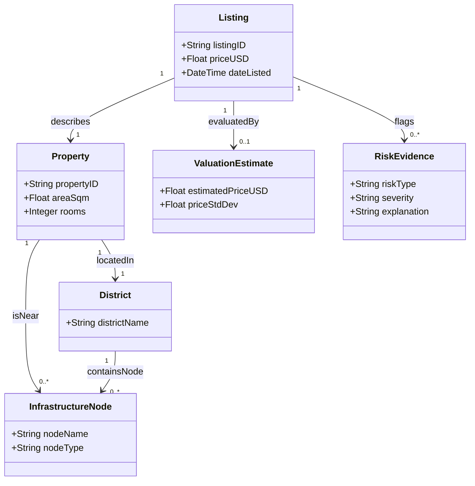

# Municipal Real Estate Ontology (`ontology/`)

This directory contains the knowledge engineering layer for the **FairRent** real estate valuation engine. It defines the formal ontology schema, relationships, spatial proximities, and rule-based risk inference logic for rental listings in Yerevan.

---

## 1. Directory Structure

```text
ontology/
├── real_estate_ontology.ttl   # OWL/RDF ontology schema & sample Yerevan instances
├── demo_inference.py          # Python verification script (SPARQL + RDFLib rules)
└── README.md                  # Ontology documentation & class diagram
```

---

## 2. Class & Relationship Diagram

The ontology models relationships between properties, listings, municipal districts, nearby infrastructure nodes (metro stations, universities), valuation estimates, and risk flags.



---

## 3. Core Ontology Components

* **Classes:**
  * `Property`: Physical real estate unit (e.g., area in sq.m., room count).
  * `Listing`: Market rental advertisement containing price data.
  * `District` / `CentralDistrict`: Municipal administrative zones (e.g., Kentron, Arabkir).
  * `InfrastructureNode` (`MetroStation`, `University`): Points of interest influencing property value (e.g., Yeritasardakan Metro, UFAR).
  * `RiskEvidence`: Flags generated by heuristic rules or ML models for anomalous or predatory listings.

* **Data Properties:**
  * `hasPriceUSD`, `hasAreaSqm`, `hasRooms`, `hasDistanceMeters`, `hasSeverity`.

---

## 4. Competency Questions & Inference Rules

1. **Competency Question 1:** *Which listings are located in Kentron and close to Yeritasardakan Metro?*
   * Answered via a SPARQL query filtering by district label and nearby infrastructure nodes.
2. **Competency Question 2 & Rule Inference:** *Identify listings exhibiting predatory pricing traits.*
   * **Rule Logic:** Listings with monthly prices exceeding thresholds (e.g., $> \$1200$/month for 1-room properties) are dynamically tagged with a `HIGH` risk severity instance linked via `:flagsRisk`.

---

## 5. How to Run the Verification Script

### Prerequisites
Install the required library:
```bash
pip install rdflib
```

### Execution
Run the verification script from the root or `ontology/` folder:
```bash
py demo_inference.py
```
*(or `python demo_inference.py`)*